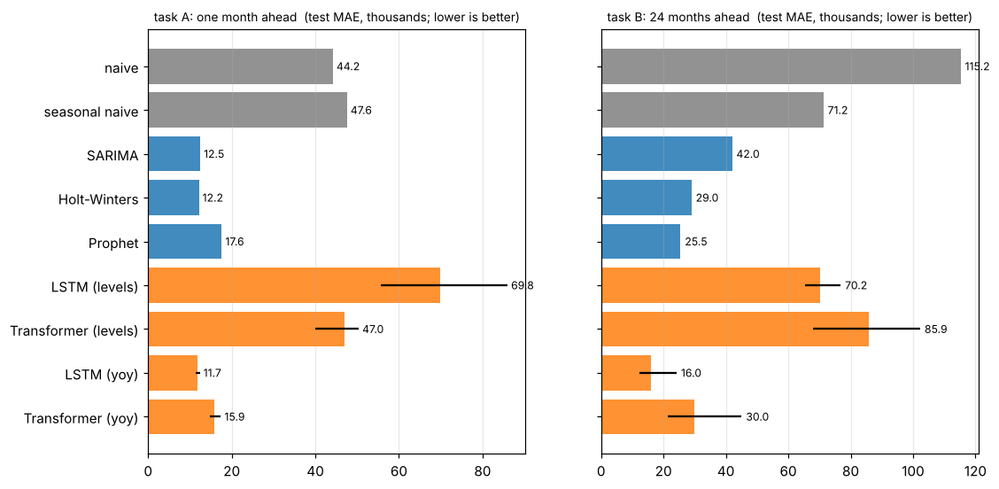

# Forecasting airline passengers: from a broken LSTM to a fair comparison

> **What this repository shows.** In 2023 I tried to forecast the monthly number of airline passengers with an LSTM; the notebook stopped with an error and never produced a forecast.
> Here the same problem is redone as a **fair comparison on one shared time-ordered split**: simple baselines, ARIMA, exponential smoothing and Prophet (notebook 01, ready),
> then an LSTM and a small Transformer (notebook 02, ready), with honest metrics.

[](https://colab.research.google.com/github/maryammahmoudi1993/LSTM_passenges_prediction/blob/main/notebooks/01_shared_split_and_classical_baselines.ipynb)

> **Status:** both notebooks are ready.

## Who this is for

- **For:** anyone who wants to see how to compare forecasting models fairly, and what a modest, honest "growth" story of a learning project looks like.
- **Prerequisites:** basic Python and pandas. **Time:** about 10 minutes for notebook 01 and 15 minutes for notebook 02 (together about ten minutes of computing on a laptop CPU).

## The setup in one picture


<p align="center">
  <br>
  <em>Task B: forecasts made at the end of 1958 for the 24 months of 1959 and 1960. All classical models underestimate the 1960 summer peak.</em>
</p>

## How to run

**In the browser:** click the Colab badge (Colab needs `pip install prophet` first; the first cell downloads this repository).

**On your computer** (Python 3.13 was tested):

```bash
git clone https://github.com/maryammahmoudi1993/LSTM_passenges_prediction.git
cd LSTM_passenges_prediction
python -m venv .venv
source .venv/bin/activate
pip install -r requirements.txt
python -m ipykernel install --user --name python3
jupyter lab notebooks/
```

If `jupyter` is not found, run `pip install jupyterlab` first (it is not needed to run the tests). Check that everything works (about eight minutes: it runs both notebooks):

```bash
python -m pytest -q
```

## Contents

| # | Notebook | What it does | Status |
|---|---|---|---|
| 01 | [One fair test for every model](notebooks/01_shared_split_and_classical_baselines.ipynb) | the data, the shared split and its rules, baselines, SARIMA, Holt-Winters, Prophet, test results, Prophet's components | ready |
| 02 | [LSTM and a small Transformer on the same split](notebooks/02_lstm_and_transformer_on_the_same_split.ipynb) | the same rules for neural networks, levels versus year-over-year changes, 5 seeds, all models in one table and one plot, the Transformer's attention | ready |

Other folders: [`src/`](src) shared code, [`tests/`](tests) smoke tests and a test that runs every notebook, [`data/`](data) the series (2 KB) and its notes,
[`legacy/`](legacy) the original 2023 files (untouched) and [`assets/`](assets) figures with [credits](assets/CREDITS.md).

## Results (all models, same split)

Test months: January 1959 to December 1960 (24 months), used once. All numbers come from running notebook 02 (the classical models are deterministic; neural models: mean of 5 seeds and, in brackets, the smallest to the largest value). MAE is in thousands of passengers.

<p align="center">
  <br>
  <em>Test MAE of every model for both tasks (grey: baselines, blue: classical models, orange: neural networks; thin line: spread over the five seeds).</em>
</p>

| Model | Task A: one month ahead | Task B: 24 months ahead |
|---|---|---|
| naive / seasonal naive | 44.2 / 47.6 | 115.2 / 71.2 |
| SARIMA(1,1,0)(0,1,1) on the log | 12.5 | 42.0 |
| Holt-Winters | 12.2 | 29.0 |
| Prophet | 17.6 | 25.5 |
| LSTM on levels | 69.8 (55.6 to 86.0) | 70.2 (65.4 to 76.8) |
| Transformer on levels | 47.0 (40.1 to 50.4) | 85.9 (67.9 to 102.3) |
| **LSTM on year-over-year changes** | **11.7 (11.3 to 12.4)** | **16.0 (12.3 to 24.2)** |
| Transformer on year-over-year changes | 15.9 (14.8 to 17.4) | 30.0 (21.4 to 45.1) |

**Conclusions, honestly.** (1) The *representation* mattered more than the model type: on raw levels the neural networks fail (they cannot predict values above the training range); on year-over-year changes the LSTM becomes the best model. (2) In task A the best LSTM, Holt-Winters and SARIMA are tied (the LSTM's seed range contains the Holt-Winters value). In task B the LSTM is clearly ahead on average (16.0 versus 25.5 for Prophet) but with a large spread over seeds. (3) The year-over-year representation contains the seasonal-naive idea by construction, so part of the success is structure, not the network. (4) The small Transformer is on par with the classical models at best. With 24 test months and one series, only the large gaps are safe conclusions.

### Notebook 01 detail (the classical models)

| Task | Model | MAE | RMSE | MAPE |
|---|---|---|---|---|
| A: one month ahead (walk-forward) | naive | 44.2 | 51.8 | 9.7% |
| | seasonal naive | 47.6 | 50.0 | 10.5% |
| | SARIMA(1,1,0)(0,1,1) on the log | 12.5 | 15.8 | 2.8% |
| | Holt-Winters (damped trend, multiplicative) | 12.2 | 16.0 | 2.7% |
| | Prophet (multiplicative) | 17.6 | 21.9 | 3.8% |
| B: 24 months ahead | naive | 115.2 | 137.3 | 23.6% |
| | seasonal naive | 71.2 | 77.0 | 15.5% |
| | SARIMA(1,1,0)(0,1,1) on the log | 42.0 | 45.7 | 9.1% |
| | Holt-Winters (trend, multiplicative) | 29.0 | 32.5 | 6.4% |
| | Prophet (multiplicative) | 25.5 | 30.6 | 5.4% |

In task A, SARIMA and Holt-Winters are practically tied and 3.5 to 4 times better than the baselines. In task B all errors are two to three times larger and the ranking changes (Prophet first). With 24 test months, small gaps mean little.
The settings of every model were chosen on the validation months only (the notebook lists all candidates, including one that failed numerically).

## Then versus now

| | **Then (January 2023, in [`legacy/`](legacy))** | **Now** |
|---|---|---|
| Result | the training cell stops with a `ValueError`; no forecast was ever produced | forecasts and a results table for every model on the same test months, including a working LSTM and a small Transformer |
| Input | a model built for 143 features per step (143 is the length of the series) | one value per month; neural networks see windows of the last 12 months, scaled with training statistics only |
| Target | the target of each window is the last value inside the window (leakage; checked with a small example) | a forecaster only sees data before the month it predicts, enforced and tested in code |
| Data | first month dropped by `iloc[1:]` | all 144 months |
| Baseline | none | naive and seasonal naive |
| Evaluation | no metric in the original units | MAE, RMSE, MAPE; validation for choices, test used once; two tasks; five seeds for neural models |

What I would do differently, and did: start with baselines, write the split and the rules down before training anything, and test that the code cannot peek into the future.
See [`legacy/ABOUT.md`](legacy/ABOUT.md) for what I notice in the original notebook today.

## Limitations

- **One series, 144 points, 24 test months:** the results do not say how the models behave on other series, and small gaps between models are not meaningful.
- The test months (the highest values of the series) lie outside the range of the training data, which favours models that extrapolate a trend.
- Only a few settings per model family were tried; the notebook lists them all.
- No prediction intervals or statistical tests are reported.
- Neural models were trained on about 100 windows: a tiny data set for deep learning; results for the Transformer in particular may differ with more data.
- The best neural model uses a representation (year-over-year changes) that builds in last year's value; the plain-levels versions fail.
- The data licence could not be verified (see [`data/README.md`](data/README.md)).

## Further reading

- Hyndman and Athanasopoulos, *Forecasting: Principles and Practice* (free online book): <https://otexts.com/fpp3/>.
- Box and Jenkins, *Time Series Analysis: Forecasting and Control* (the source of the airline series and of the SARIMA family).
- Vaswani et al. (2017), *Attention Is All You Need*, <https://arxiv.org/abs/1706.03762> (the Transformer).
- Hochreiter and Schmidhuber (1997), *Long Short-Term Memory*, Neural Computation 9(8), 1735-1780 (the LSTM).
- Taylor and Letham (2018), *Forecasting at scale*, The American Statistician 72(1), 37-45 (Prophet).
- Documentation of [statsmodels](https://www.statsmodels.org/) (SARIMAX, Holt-Winters, STL) and [Prophet](https://facebook.github.io/prophet/).

## License

MIT, see [`LICENSE`](LICENSE). The data file has its own provenance, see [`data/README.md`](data/README.md).
